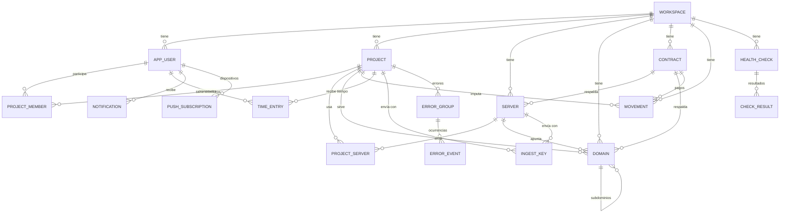

# Modelo de datos

Estado: diseño cerrado (2026-10-28). Base de datos: PostgreSQL, migraciones con Flyway.

## Convenciones

- Identificadores: **UUID** en todas las tablas.
- Dinero: `numeric(10,2)` en base de datos, `BigDecimal` en Java. Siempre en euros, importe total sin desglose de IVA.
- Enumerados: guardados como texto (`@Enumerated(EnumType.STRING)`).
- Fechas y horas: con zona horaria (`timestamptz`).
- La tabla de usuarios se llama `app_user` porque `user` es palabra reservada en PostgreSQL.
- Nunca se guardan contraseñas de servidores.

## Diagrama de relaciones

## Bloque 1: personas y permisos

### `workspace`
| Campo | Tipo | Notas |
|---|---|---|
| `id` | UUID | PK |
| `name` | texto | |
| `created_at` | timestamptz | |

### `app_user`
| Campo | Tipo | Notas |
|---|---|---|
| `id` | UUID | PK |
| `workspace_id` | UUID | FK. Un usuario pertenece a un único workspace |
| `email` | texto, único | login |
| `password_hash` | texto | nunca en claro |
| `display_name` | texto | |
| `role` | `ADMIN` / `MEMBER` | rol global |
| `hourly_rate` | numeric(8,2), opcional | tarifa por defecto, solo visible para ADMIN |
| `active` | boolean | desactivar sin borrar |
| `created_at` | timestamptz | |

### `project`
| Campo | Tipo | Notas |
|---|---|---|
| `id` | UUID | PK |
| `workspace_id` | UUID | FK |
| `name` | texto | |
| `description` | texto | |
| `status` | `IDEA` / `DEVELOPMENT` / `PRODUCTION` / `PAUSED` | |
| `repo_url` | texto, opcional | |
| `public_url` | texto, opcional | |
| `notes` | texto, opcional | |
| `created_at`, `updated_at` | timestamptz | |

### `project_member`
| Campo | Tipo | Notas |
|---|---|---|
| `project_id` | UUID | PK compuesta, FK |
| `user_id` | UUID | PK compuesta, FK |
| `role` | `OWNER` / `EDITOR` / `VIEWER` | rol dentro del proyecto |
| `added_at` | timestamptz | |

## Bloque 2: recursos contratados

### `contract`
| Campo | Tipo | Notas |
|---|---|---|
| `id` | UUID | PK |
| `workspace_id` | UUID | FK |
| `name` | texto | |
| `provider` | texto | |
| `type` | `SERVER` / `DOMAIN` / `OTHER` | el tipo hace de categoría |
| `amount` | numeric(10,2) | importe por periodo |
| `billing_period` | `MONTHLY` / `YEARLY` | |
| `renewal_date` | date | próximo vencimiento; dispara los avisos |
| `auto_renew` | boolean | |
| `status` | `ACTIVE` / `CANCELLED` | |
| `notes` | texto, opcional | |

### `server`
| Campo | Tipo | Notas |
|---|---|---|
| `id` | UUID | PK |
| `workspace_id` | UUID | FK |
| `contract_id` | UUID, opcional | FK |
| `name`, `provider` | texto | |
| `ip_address` | texto | |
| `os` | texto | |
| `cpu_cores`, `ram_mb`, `disk_gb` | entero | |
| `notes` | texto, opcional | sin contraseñas |

### `domain`
Sirve para dominios y subdominios.

| Campo | Tipo | Notas |
|---|---|---|
| `id` | UUID | PK |
| `workspace_id` | UUID | FK |
| `name` | texto | nombre completo, p. ej. `api.ejemplo.com` |
| `parent_id` | UUID, opcional | FK a `domain`; si está, es subdominio |
| `contract_id` | UUID, opcional | solo dominios raíz; los subdominios heredan del padre |
| `server_id` | UUID, opcional | servidor al que apunta |
| `project_id` | UUID, opcional | proyecto al que sirve |
| `registrar` | texto, opcional | |
| `notes` | texto, opcional | |

### `project_server`
| Campo | Tipo | Notas |
|---|---|---|
| `project_id` | UUID | PK compuesta, FK |
| `server_id` | UUID | PK compuesta, FK |
| `cost_share_percent` | numeric(5,2) | % del coste del servidor que carga el proyecto |

## Bloque 3: dinero y tiempo

### `movement`
Gastos e ingresos reales fuera de contrato. Solo visible para ADMIN.

| Campo | Tipo | Notas |
|---|---|---|
| `id` | UUID | PK |
| `workspace_id` | UUID | FK |
| `type` | `EXPENSE` / `INCOME` | |
| `amount` | numeric(10,2) | siempre positivo |
| `date` | date | |
| `description` | texto | |
| `project_id` | UUID, opcional | FK |
| `contract_id` | UUID, opcional | FK |
| `recurrence` | `ONE_TIME` / `MONTHLY` / `YEARLY` | |
| `ends_on` | date, opcional | fin de la recurrencia |

### `time_entry`
| Campo | Tipo | Notas |
|---|---|---|
| `id` | UUID | PK |
| `user_id` | UUID | FK |
| `project_id` | UUID | FK |
| `started_at` | timestamptz | |
| `ended_at` | timestamptz, opcional | nulo mientras el cronómetro corre |
| `hourly_rate` | numeric(8,2), opcional | copia de la tarifa del usuario al iniciar |
| `description` | texto, opcional | |

La duración no se guarda, se calcula. Un **índice único parcial** sobre `user_id` donde `ended_at IS NULL` garantiza un solo cronómetro en marcha por usuario.

## Bloque 4: monitorización y avisos

### `health_check`
| Campo | Tipo | Notas |
|---|---|---|
| `id` | UUID | PK |
| `workspace_id` | UUID | FK |
| `name` | texto | |
| `type` | `HTTP` / `SSL` / `PING` / `TCP_PORT` | |
| `target` | texto | URL o host |
| `port` | entero, opcional | para `TCP_PORT` |
| `server_id`, `domain_id`, `project_id` | UUID, opcionales | definen quién lo ve |
| `interval_seconds` | entero | por defecto 300 (5 min) |
| `timeout_ms` | entero | |
| `failure_threshold` | entero | por defecto 3 |
| `enabled` | boolean | |
| `current_status` | `UP` / `DOWN` / `UNKNOWN` | |
| `consecutive_failures` | entero | |
| `last_checked_at`, `status_changed_at` | timestamptz | |

### `check_result`
| Campo | Tipo | Notas |
|---|---|---|
| `id` | UUID | PK |
| `health_check_id` | UUID | FK |
| `checked_at` | timestamptz | |
| `success` | boolean | |
| `response_ms` | entero, opcional | |
| `status_code` | entero, opcional | solo HTTP |
| `error` | texto, opcional | |
| `ssl_expires_at` | timestamptz, opcional | solo SSL |

Los resultados se purgan a los **30 días** con una tarea programada.

### `notification`
| Campo | Tipo | Notas |
|---|---|---|
| `id` | UUID | PK |
| `user_id` | UUID | destinatario, FK |
| `type` | `CONTRACT_EXPIRING` / `CHECK_DOWN` / `CHECK_RECOVERED` / `SSL_EXPIRING` / `APP_ERROR` | `APP_ERROR` desde V6 |
| `severity` | `INFO` / `WARNING` / `CRITICAL` | |
| `title`, `message` | texto | |
| `contract_id`, `health_check_id`, `error_group_id` | UUID, opcionales | `error_group_id` desde V6 |
| `dedupe_key` | texto, único por usuario (`user_id`, `dedupe_key`) | evita avisos repetidos, p. ej. `contract:{id}:30d:{renewal_date}`; el mismo aviso puede llegar a varios usuarios |
| `created_at` | timestamptz | |
| `read_at` | timestamptz, opcional | nulo = no leído |

### `push_subscription`
| Campo | Tipo | Notas |
|---|---|---|
| `id` | UUID | PK |
| `user_id` | UUID | FK |
| `endpoint` | texto, único | |
| `p256dh`, `auth` | texto | claves de Web Push |
| `user_agent` | texto | |
| `created_at` | timestamptz | |

## Bloque 5: datos que envían tus apps (V6)

### `ingest_key`
Clave con la que una app o un servidor envía datos al panel (`Authorization: Bearer <clave>`).

| Campo | Tipo | Notas |
|---|---|---|
| `id` | UUID | PK |
| `workspace_id` | UUID | FK |
| `project_id`, `server_id` | UUID, opcionales | al menos uno; los errores necesitan proyecto |
| `name` | texto | p. ej. «Producción» |
| `key_hash` | texto(64), único | SHA-256 de la clave; **la clave en claro no se guarda** |
| `key_prefix` | texto | primeros caracteres, para reconocerla |
| `created_at`, `last_used_at`, `revoked_at` | timestamptz | revocada = inválida para siempre |

### `error_group`
Un mismo error de una app: mismo tipo y misma pila (sin números de línea).

| Campo | Tipo | Notas |
|---|---|---|
| `id` | UUID | PK |
| `project_id` | UUID | FK |
| `fingerprint` | texto(64) | huella; único por proyecto |
| `type`, `message` | texto | el mensaje es el de la última vez |
| `status` | `OPEN` / `RESOLVED` | si vuelve a ocurrir estando resuelto, se reabre y avisa |
| `occurrences` | entero | total histórico (no se purga) |
| `first_seen_at`, `last_seen_at`, `resolved_at` | timestamptz | |

### `error_event`
Cada vez que ocurrió. Se purgan a los **30 días**.

| Campo | Tipo | Notas |
|---|---|---|
| `id` | UUID | PK |
| `group_id` | UUID | FK |
| `occurred_at` | timestamptz | |
| `message`, `stack` | texto | pila hasta 32 KB |
| `environment`, `release` | texto, opcionales | |
| `context` | texto (JSON) | datos de la petición: URL, método... |

## Reglas de negocio

**Visibilidad**
- `ADMIN`: ve todo el workspace, incluidos contratos, costes, ingresos y tarifas.
- `MEMBER`: ve solo los proyectos donde figura en `project_member`, y de ellos: los servidores vinculados vía `project_server`, sus dominios y sus comprobaciones de estado. Nunca importes, contratos ni finanzas.

**Costes**
- El coste recurrente de un proyecto se **calcula** desde los contratos de sus servidores, repartido según `cost_share_percent`. No se registra un `movement` por cada pago.
- `movement` se usa para ingresos y para gastos puntuales o reales fuera de contrato.
- El coste del tiempo es la suma de horas de `time_entry` por su `hourly_rate`.

**Avisos**
- Contratos: avisos a **30, 15 y 7 días** del `renewal_date`, umbrales globales de la aplicación.
- Estado: comprobación cada **5 minutos**, alerta tras **3 fallos consecutivos**.
- Destinatarios: contratos y costes, solo `ADMIN`. Caídas y SSL, el `ADMIN` y los miembros de los proyectos afectados.
- Cada aviso lleva una `dedupe_key`, única por usuario, para que la tarea programada no lo repita.

**Vigilancia de la propia app**
- La app vive en IONOS y vigila Contabo. La caída de IONOS se detecta con un latido inverso desde Contabo (`cron` + `curl`) que avisa por Telegram.
